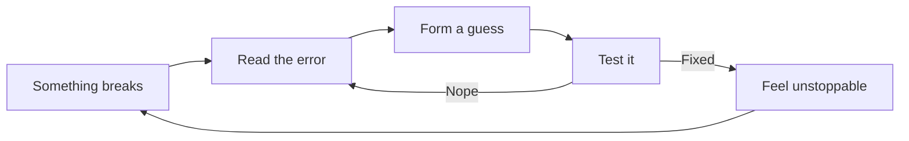

```bash
$ whoami
meng

$ cat about.txt
CS student · AI-curious · professional bug hunter (in training)
```

# Hey, I'm Meng 👋

I like taking things apart to see how they work, then putting them back together a little better.
Right now that means software engineering, a growing obsession with AI, and a lot of debugging.

<br>

## 🔄 How I Debug



<sub>Yes, I enjoy this loop more than I probably should.</sub>

<br>

## 🧰 Tools I Reach For

<kbd> Python </kbd> <kbd> Java </kbd> <kbd> C++ </kbd> <kbd> JavaScript </kbd> <kbd> HTML </kbd> <kbd> CSS </kbd> <kbd> React </kbd> <kbd> Git </kbd> <kbd> Linux </kbd>

<br>

## 🎯 Leveling Up

| Skill | Progress |
| :-- | :-- |
| Data structures & algorithms | `▰▰▰▰▰▰▱▱▱▱` |
| Clean code & best practices | `▰▰▰▰▰▱▱▱▱▱` |
| System design | `▰▰▰▱▱▱▱▱▱▱` |
| Open-source contributions | `▰▰▱▱▱▱▱▱▱▱` |

<sub>Honest self-assessment, updated as I grow.</sub>

<br>

## 💬 Ask Me About

- Why a bug only shows up when you stop looking at it
- How I'm learning algorithms and system design
- Getting started with AI as a CS student

<br>

## 📈 Activity


<br>

## 📬 Say Hi

[meng6828@gmail.com](mailto:meng6828@gmail.com)

<br>

```python
while True:
    learn()
    build()
```
